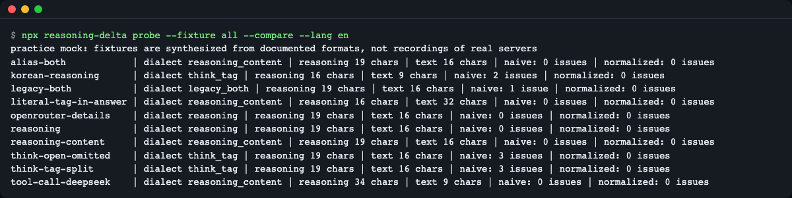
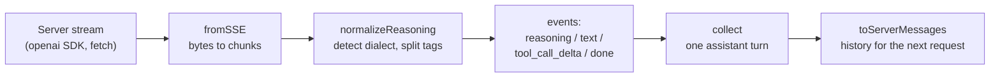
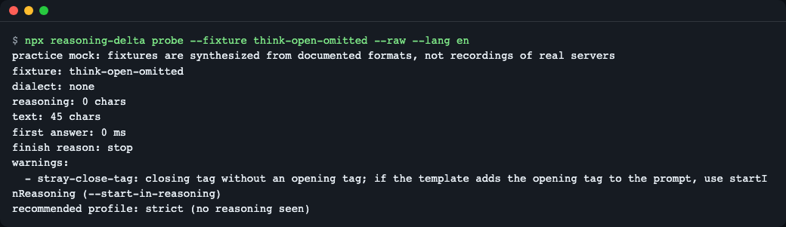
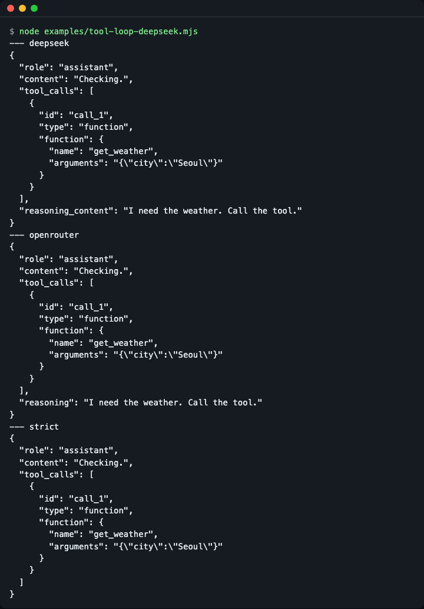
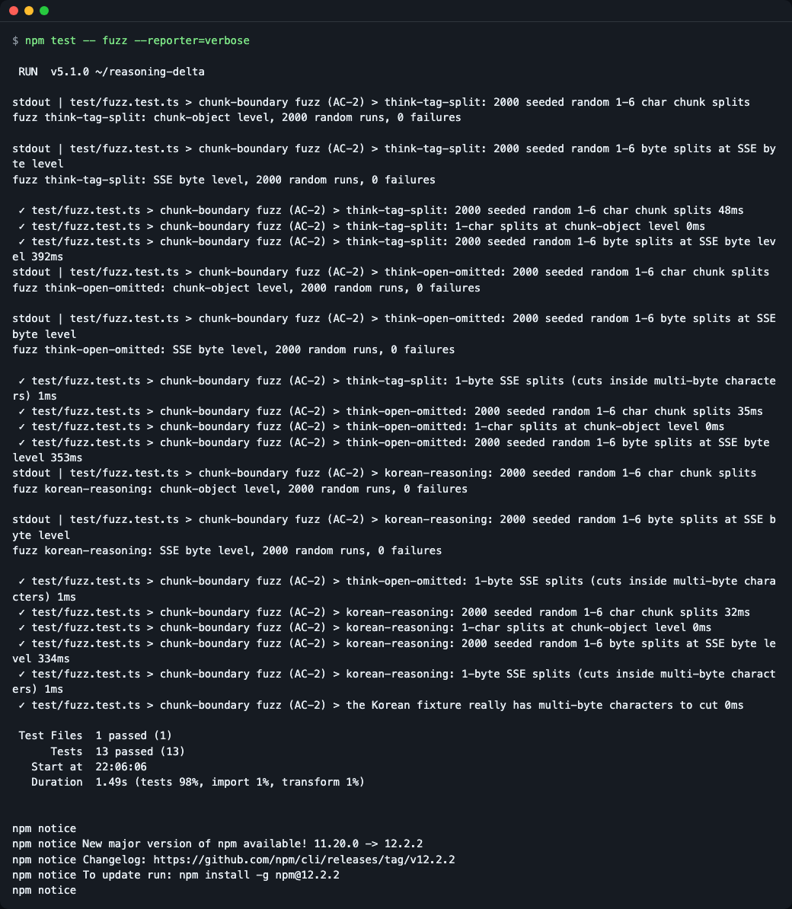

# reasoning-delta

**English** | [한국어](README.ko.md)

Reasoning models behind OpenAI-compatible servers put their "thinking" in different places: `delta.reasoning_content`, `delta.reasoning`, `<think>` tags inside `content`, or two of these at once. `reasoning-delta` reads any of them from a Chat Completions stream, even when a tag is cut between two chunks, and gives you one event shape: `reasoning`, `text`, `tool_call_delta`, `reasoning_details`, `done`. It also rewrites the conversation history for the next request with each server's reasoning rules. TypeScript, zero runtime dependencies, Node 22+.



*Ten bundled practice fixtures. "naive" is a plain `delta.reasoning_content ?? nothing` reader with a per-chunk `<think>` regex; "normalized" is `reasoning-delta`. The fixtures are synthetic (see [Fixtures are synthetic](#fixtures-are-synthetic)).*

## Install

```bash
npm install reasoning-delta
```

Needs Node 22 or newer (`brew install node`, `apt install nodejs`, or [nodejs.org](https://nodejs.org)). The package has no runtime dependencies. It is ESM-first and also loads with `require()` on Node versions that support `require(esm)`.

Until the package is published to npm, `npm install reasoning-delta` fails with a 404. In that case use the source install below.

To try the current source instead:

```bash
git clone https://github.com/LeeGyeongPil/reasoning-delta.git
cd reasoning-delta
npm install
npm run build
```

## Quick start

No server and no key needed:

```js
import { normalizeReasoning } from 'reasoning-delta';

// A <think> tag cut in half between two chunks, as a real network would do.
const chunk = (content) => ({ choices: [{ index: 0, delta: { content }, finish_reason: null }] });
async function* stream() {
  for (const piece of ['<thi', 'nk>Let me add 2 and 2.</th', 'ink>\n\nThe answer is 4.']) yield chunk(piece);
}

for await (const ev of normalizeReasoning(stream())) console.log(ev);
```

```text
{ type: 'reasoning', text: 'Let me add 2 and 2.', source: 'tag' }
{ type: 'text', text: 'The answer is 4.' }
{
  type: 'done',
  dialect: 'think_tag',
  finishReason: null,
  warnings: []
}
```

No tag fragment leaked into the answer, and the reasoning is separate. Try the command line version without writing code (it replays bundled fixtures, no key needed):

```bash
npx reasoning-delta probe --fixture all --compare
```

## Core concepts



1. **Dialect.** Where a server puts the reasoning text. `reasoning-delta` recognises `reasoning_content` (field), `reasoning` (field), `think_tag` (tags in `content`), `legacy_both` (field and tags carry the same text) and `none`. The detected one is reported in the `done` event.
2. **Chunk-safe tag splitter.** If the end of a chunk could be the start of a tag (`<`, `<th`, `</thi`), only that part is held back until the next chunk decides. At the end of the stream a held fragment is flushed as reasoning (if a tag was open) or as text. A seeded fuzz test cuts three fixtures at random 2000 times each at chunk level and at SSE byte level (including inside multi-byte Korean characters), with 0 failures.
   Example: the stream arrives as `<thi` + `nk>Let me…`.

   | Chunk | Held back | Emitted |
   |---|---|---|
   | `<thi` | `<thi` (could be a tag start) | nothing yet |
   | `nk>Let me…` | nothing (`<think>` is complete, reasoning begins) | `reasoning: "Let me…"` |
3. **Duplicate guard.** Some servers send the same reasoning in a field and in `<think>` tags. Once a field reasoning has been seen, tag sections in `content` are dropped, so the reasoning is emitted once. Limit: if tag reasoning already went out before the first field chunk, it cannot be taken back.
4. **Send-back profile.** A named set of rules for the next request: which field to write the reasoning into, and when. The rules differ by server.



*`--raw` ignores the options a fixture declares. The stream has `</think>` but no opening tag, so the tool warns and suggests `startInReasoning`.*

## API

Everything below is exported from `reasoning-delta`.

| Name | What it does | Main arguments | Returns |
|---|---|---|---|
| `normalizeReasoning(source, options?)` | Turns chunks into events. Accepts the openai SDK `Stream`, any async iterable of chunk objects, or `fromSSE(...)`. | `source`, `NormalizeOptions` | `AsyncGenerator<ReasoningEvent>` |
| `fromSSE(body)` | Parses a Server-Sent Events body (handles `\n`, `\r\n`, `\r`, comments, multi-line `data:`, `[DONE]`, UTF-8 cut across byte chunks). Throws `SSEParseError` on bad JSON or on a body with no SSE events (for example an HTML error page). | `ReadableStream`, async iterable, iterable or string | `AsyncGenerator<ChunkLike>` |
| `collect(events)` | Drains events into one turn. | event stream | `Promise<AssistantTurn>` (`content`, `reasoning`, `reasoningDetails`, `toolCalls`, `finishReason`, `dialect`, `warnings`, `usage`) |
| `toAssistantMessage(turn)` | Makes a history message from a collected turn. | `AssistantTurn` | `MessageLike` |
| `normalizeMessage(message, options?)` | Same splitting for a complete (non-streaming) message. | message, `NormalizeOptions` | `{ content, reasoning, dialect }` |
| `toServerMessages(history, profile, opts?)` | Returns a new history written for a server. Does not modify the input. `opts.hasTools` defaults to true when the history has tool calls or tool messages. | history, profile name or object | `MessageLike[]` |
| `profiles` | Built-in profiles: `deepseek`, `vllm`, `llamacpp`, `llamacpp-legacy`, `openrouter`, `ollama`, `think-tag`, `strict`. | | `Record<ProfileName, ServerProfile>` |
| `defineProfile(profile)` | Typed helper for your own profile. | `ServerProfile` | the same object |
| `TagSplitter`, `DEFAULT_TAGS` | The tag splitter itself and the default tag names (`think`, `reasoning`, `thought`). | `TagSplitterOptions` | |
| `SSEParseError`, `UnknownProfileError`, `StreamError` | Errors: bad SSE JSON; unknown profile name; an `error` object inside the stream. | | |

Types: `ReasoningEvent`, `AssistantTurn`, `ChunkLike`, `DeltaLike`, `MessageLike`, `NormalizeOptions`, `ServerProfile`, `SendBackRule`, `Dialect`, `Warning`, `TagMode`, `ProfileName`, `ToolCallTurn`, `Segment`, `SegmentKind`, `TagSplitterOptions`.

Events:

| Event | Fields |
|---|---|
| `reasoning` | `text`, `source` (`'field'` or `'tag'`) |
| `text` | `text` |
| `tool_call_delta` | `index`, `id?`, `name?`, `arguments?` |
| `reasoning_details` | `details` (the array as the server sent it) |
| `done` | `dialect`, `finishReason`, `warnings`, `usage?` |

`NormalizeOptions`:

| Option | Default | Meaning |
|---|---|---|
| `profile` | `'auto'` | A profile name or object whose read hints apply; `'auto'` relies on detection only. |
| `tags` | `['think', 'reasoning', 'thought']` | Tag names that wrap reasoning inside `content`. |
| `tagMode` | `'leading'` | `'leading'`: a tag counts only before the first visible answer character, so a literal `<think>` later in the answer stays text. `'anywhere'`: at any point. `'off'`: tags are plain text. |
| `startInReasoning` | `false` | The opening tag is missing (some chat templates put it in the prompt); the stream starts inside reasoning. |
| `choiceIndex` | `0` | Which choice to follow. |

`startInReasoning` is safe to combine with servers that send reasoning in the `reasoning_content` / `reasoning` field (when that reasoning arrives before or together with the first content): the answer is still emitted as `text`.

Warnings in `done.warnings`: `stray-close-tag` (a closing tag without an opening one; kept as text), `unclosed-tag` (stream ended inside a tag; held text flushed as reasoning), `alias-mismatch` (`reasoning_content` and `reasoning` differ in one chunk; `reasoning_content` is used).

## Usage examples

All three files are in [`examples/`](examples) and run against a local practice mock server that sends a bundled fixture 3 bytes at a time.

### With the openai SDK

```js
import OpenAI from 'openai';
import { normalizeReasoning } from 'reasoning-delta';

const client = new OpenAI({ apiKey: 'not-needed', baseURL: 'http://localhost:11434/v1' });
const stream = await client.chat.completions.create({
  model: 'qwen3',
  messages: [{ role: 'user', content: 'What is 2 + 2?' }],
  stream: true,
});
for await (const ev of normalizeReasoning(stream)) {
  if (ev.type === 'reasoning') process.stdout.write(`\x1b[2m${ev.text}\x1b[0m`); // dim
  else if (ev.type === 'text') process.stdout.write(ev.text);
}
```

(The URL and model are an example for your own server. The runnable file uses the mock.) Verified run of the file:

```bash
node examples/openai-sdk.mjs think-tag-split
```

```text
(practice mock: fixture "think-tag-split", sent 3 bytes at a time)

Let me add 2 and 2.The answer is 4.
[done: dialect=think_tag finish=stop warnings=none]
```

The reasoning part is printed dim on a real terminal; this copy has no color codes.

### With plain `fetch`

```js
import { fromSSE, normalizeReasoning } from 'reasoning-delta';

const res = await fetch(`${baseUrl}/chat/completions`, {
  method: 'POST',
  headers: { 'content-type': 'application/json' },
  body: JSON.stringify({ model, stream: true, messages }),
});
for await (const ev of normalizeReasoning(fromSSE(res.body))) console.log(ev);
```

`node examples/fetch.mjs` runs the same thing on the Korean fixture, where 3-byte writes cut Hangul characters in the middle; they still come out whole:

```text
2 더하기 2를 계산해 보자.정답은 4입니다.
[done: dialect=think_tag finish=stop warnings=none]
```

### A tool loop that sends reasoning back

`collect()` gathers one streamed turn, `toAssistantMessage()` makes the history message, and `toServerMessages()` writes it for a server.

```js
const turn = await collect(normalizeReasoning(fromSSE([text])));
const history = [
  { role: 'user', content: 'Weather in Seoul?' },
  toAssistantMessage(turn),
  { role: 'tool', tool_call_id: turn.toolCalls[0].id, content: '{"temp_c": 18}' },
];
for (const profile of ['deepseek', 'openrouter', 'strict']) {
  console.log(JSON.stringify(toServerMessages(history, profile)[1], null, 2));
}
```



*`node examples/tool-loop-deepseek.mjs`: DeepSeek gets `reasoning_content`, OpenRouter gets `reasoning`, a strict server gets no reasoning field.*

### Diagnose an endpoint

```bash
npx reasoning-delta probe --base-url http://localhost:11434/v1 --model qwen3
npx reasoning-delta probe --base-url https://api.deepseek.com --model <model> --api-key-env DEEPSEEK_API_KEY
```

Real mode sends one short request and reports the dialect, the first reasoning and first answer latency, character counts and a recommended profile. The key is read from the environment variable whose *name* you pass (default `OPENAI_API_KEY` if set); never pass the key itself on the command line. Flags: `--prompt`, `--timeout <seconds>` (default 60), `--json`, `--start-in-reasoning`. Practice mock mode (no network) uses `--fixture <name|all|path.sse>`, `--compare` (show the naive reader next to the normalized one) and `--raw` (ignore the options a fixture declares); see `reasoning-delta --help`. Exit code 0 on success, 1 on a run error, 2 on bad arguments. Real mode was only tested against a local mock server (see [What is verified](#what-is-verified)); it can be slow on shared or remote servers.

## Sending history back

`toServerMessages(history, profile)` reads the reasoning of each assistant message, removes it from `content` and from the three reasoning fields, then writes it back the way the profile says. A leading `<think>…</think>` block in `content` is removed for every profile; if no reasoning field exists, its text is used as the reasoning.

| Profile | Writes | Rule source (checked 2026-11-14) | Confirmed by docs? |
|---|---|---|---|
| `deepseek` | `reasoning_content` on every assistant message, only if the history has tool calls | [DeepSeek thinking mode](https://api-docs.deepseek.com/guides/thinking_mode) | yes |
| `openrouter` | `reasoning_details` unchanged and in order, plus `reasoning` | [OpenRouter reasoning tokens](https://openrouter.ai/docs/use-cases/reasoning-tokens) | yes |
| `vllm` | nothing (reasoning removed) | [vLLM reasoning outputs](https://docs.vllm.ai/en/latest/features/reasoning_outputs.html) | **unconfirmed**: the docs do not describe sending reasoning back |
| `llamacpp`, `llamacpp-legacy` | nothing (reasoning removed) | [llama.cpp server README](https://github.com/ggml-org/llama.cpp/blob/master/tools/server/README.md) | **unconfirmed** |
| `ollama` | nothing (reasoning removed) | [Ollama OpenAI compatibility](https://docs.ollama.com/api/openai-compatibility) | **unconfirmed**; the docs do not name the delta field, so detection decides |
| `think-tag` | nothing (reasoning removed) | [vLLM reasoning outputs](https://docs.vllm.ai/en/latest/features/reasoning_outputs.html) | **unconfirmed** |
| `strict` | nothing | none | not a server rule: a conservative choice for servers that reject unknown message fields |

For the unconfirmed profiles the default is the safe one (remove). If you have confirmed that your server wants something else, pass your own profile:

```js
import { defineProfile, toServerMessages } from 'reasoning-delta';

const mine = defineProfile({
  name: 'my-server',
  read: {},
  sendBack: { field: 'reasoning_content', when: 'always', details: false },
  verified: true,
  sources: ['https://example.com/your-docs'],
  checked: '2026-11-14',
});
const messages = toServerMessages(history, mine);
```

Each built-in profile lists its source URLs and check date in `profiles.<name>.sources` and `.checked`. These are what the pages said on that date; pages change, so re-check before relying on a rule.

## When to use

- Good fit: you call several OpenAI-compatible servers through the openai SDK or `fetch` and want one reading path for reasoning and one place for the send-back rules. Also good for checking where a new endpoint puts its reasoning.
- Different tools may fit better: if you build on the Vercel AI SDK, look at its own reasoning support first ([AI SDK docs](https://ai-sdk.dev/docs), `extractReasoningMiddleware`); if you only need to split tags out of a finished string, a small tag parser is enough; if your server can separate reasoning itself (for example a server-side reasoning parser option), you may not need client-side tag handling at all.

A repro script is included for one specific case: `npm run compare:ai-sdk` replays a synthetic "reasoning sent twice" fixture through `ai` 7.0.173 with `@ai-sdk/openai-compatible` 3.0.92 (with and without `extractReasoningMiddleware`) and through `reasoning-delta`. In that run (2026-11-14), the AI SDK reads the field and leaves the tags in the answer; with the middleware added the reasoning came out duplicated and interleaved (`Let me Let me add 2 and 2.add 2 and 2.`); `reasoning-delta` gave the reasoning once. The same script prints which field each side writes into the next request. The AI SDK reads both `reasoning_content` and `reasoning`. This only covers the cases in the script, not a general comparison.

## What is verified

### Fixtures are synthetic

The ten fixtures in [`fixtures/`](fixtures) are **synthesized from documented formats, not recordings of real servers**. Each file says so on its first lines and says which server it mimics. The CLI's mock mode prints the same notice. "Practice mock mode" means: no network, no key, deterministic output. Real mode talks to a real server, which depends on that server's speed and model.

- Covered by the 96 automated tests: all fixtures, random chunk splits, a real openai SDK client streaming from a local `127.0.0.1` mock server, the CLI in both languages, the packed tarball (ESM import, CJS `require`, `npx reasoning-delta --version`).
- **Not yet verified against live servers:** llama.cpp, vLLM, Ollama, DeepSeek and OpenRouter endpoints were not called. Real-mode `probe` was exercised only against the local mock server. Send-back rules marked unconfirmed above are not confirmed by the server docs.

## Troubleshooting

| Symptom | Cause | Fix |
|---|---|---|
| The answer starts with text up to `</think>` and the reasoning is empty; warning `stray-close-tag` | The chat template adds `<think>` to the prompt, so the stream has only the closing tag | `normalizeReasoning(stream, { startInReasoning: true })` or `probe --start-in-reasoning` |
| A literal `<think>` stays in the answer | Default `tagMode: 'leading'` only treats a tag as reasoning before the first visible answer character | Set `tagMode: 'anywhere'` if your model really emits reasoning later |
| `done.dialect` is `none` | The server sent no reasoning, or reasoning is switched off for that request | Check the request's reasoning/thinking parameter for that server |
| `SSEParseError` | The body is not a `stream: true` Chat Completions stream (an error page, or a body with no SSE events) | Check the status code and request body before parsing |
| `StreamError` | The server sent an `error` object inside the stream | Read `error.detail` |
| `UnknownProfileError` | Typo in a profile name | Use one of the names in `profiles`, or `defineProfile()` |

## Language

The CLI prints English or Korean. Choose with `--lang en|ko`; otherwise `REASONING_DELTA_LANG`, then `LC_ALL`, `LC_MESSAGES`, `LANG` (a value starting with `ko` means Korean); otherwise English.

```bash
npx reasoning-delta probe --fixture reasoning --lang ko
REASONING_DELTA_LANG=ko npx reasoning-delta probe --fixture all --compare
```

## Versions

Follows [SemVer](https://semver.org/). While the version is 0.x, a minor release may change the API; changes are listed in [CHANGELOG.md](CHANGELOG.md). Current version: 0.1.2.

## Development

```bash
npm install
npm test        # builds, then runs 11 test files / 96 tests
npm run build   # tsc
npm run compare:ai-sdk
```

The fuzz test alone: `npm test -- fuzz`.



*Chunk-boundary fuzz test: seeded random splits at chunk level and SSE byte level.*

## License

MIT.
